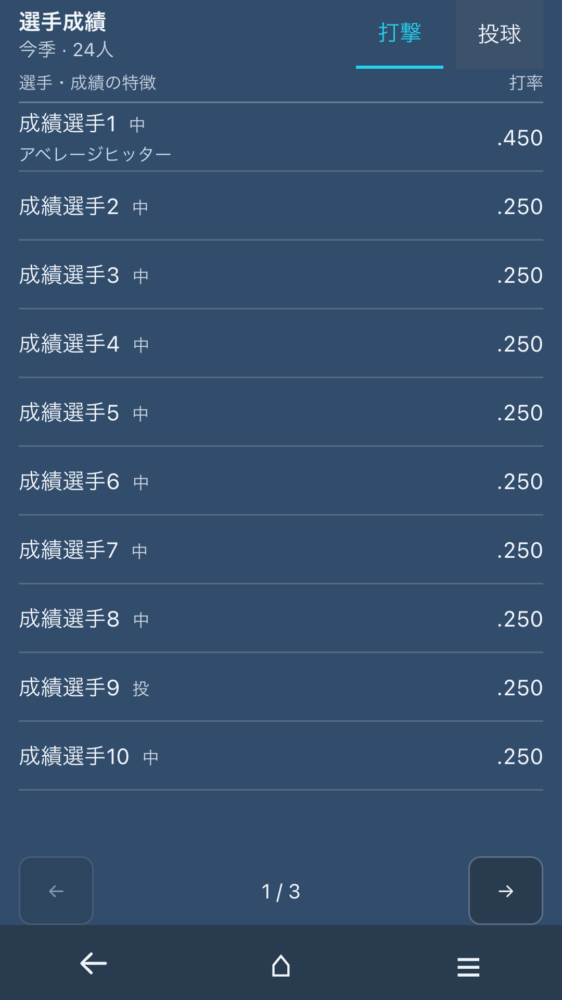
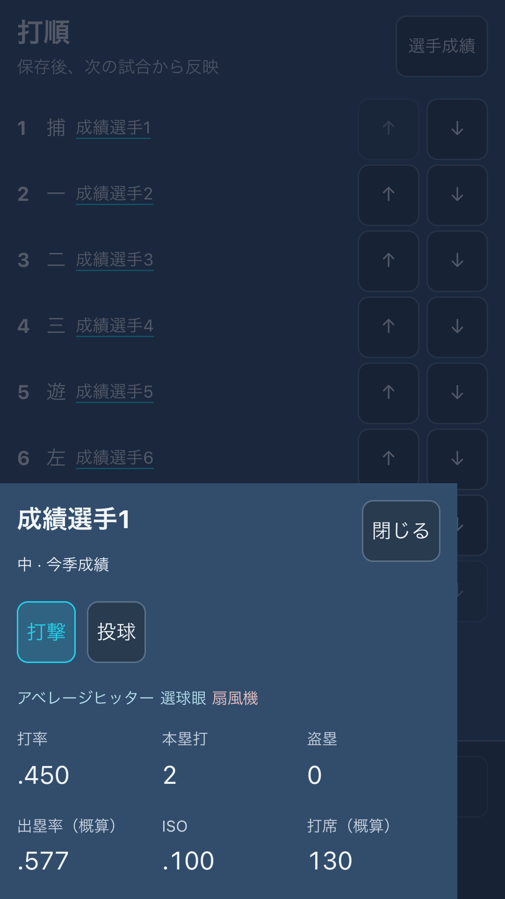
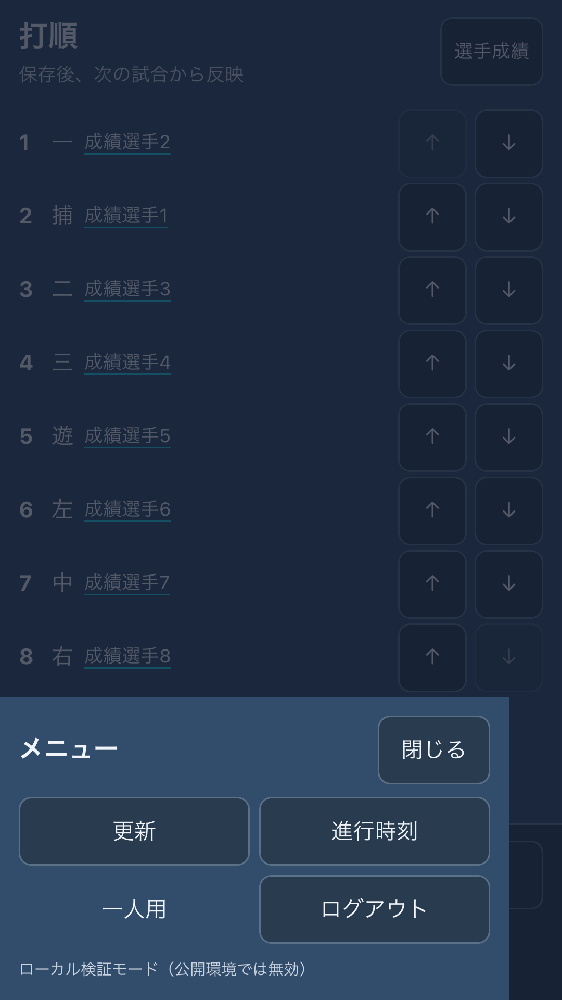

# 対人版スマホ画面の省スペース化

## 変更

- ログイン後のブランドヘッダと共通の日付・進行時刻欄を省く。球団・日付・次の進行はホームへまとめる。
- カードの外枠・角丸・影を省き、画面全体を一枚の面として使う。PCの配色は維持する。
- 常設の4画面ナビを、下部の「戻る・ホーム・メニュー」3操作へ変更。上に共通操作を置かない。
- 試合・打順・手続き・選手成績はホームから選ぶ。更新・進行時刻・一人用への移動・ログアウトは下部メニューから行う。
- 選手一覧は44pxの行で、名前・位置・代表ラベル・打率/防御率を表示する。残りの画面高から人数を算出し、3人固定にはしない。
- 選手詳細とメニューは下から開くオーバーレイ。編集中の打順を残し、閉じる・Escapeで元の操作へ戻る。その他の補助パネルの使い分けは今後の検討対象とする。
- 保存・決定の操作欄は下部3操作のすぐ上に置き、重なりを防ぐ。

## 想定画面と画像

1080×1920の縦持ち実画素を、CSS360×640・画素倍率3として検証する。実画素1080pxをそのままCSS幅にしてPC表示へ切り替えることはしない。この条件では一覧10人、ページ送り、下部3操作が縦スクロールなしで収まる。画面が高い場合は表示人数が増える。

以下は配布HTMLと実サーバー投影を接続した検証用データ。実機・実サービスの画像ではない。

|一覧|選手詳細|メニュー|
|---|---|---|
||||

## 検証・レビュー

- `build`、`lint -- --quiet`、`check:scope`、`git diff --check`。
- `check:online:label-ui`：320/360/390/767px幅、360pxは倍率3、640/844px高。人数の増加、最終行とページ送り・下部操作の位置、投打切替、全ページの到達、詳細とメニューの閉じる/Escape/フォーカス、未保存打順の保持を確認。
- `check:online:edit-ui`：画面を離れずメニューから更新し、提出の追従・復元後のお知らせ選択・ページ範囲を確認。
- `check:online:auth-ui`：既存の認証・復帰の回帰検証。
- `check:online:ui`：専用の空のFileStoreと実APIで二人分の進行・編成・端末交代・試合結果を確認。
- 新しいホームで未完了の手続きマーカーがボタン名に混ざる問題を検出し、明示的なアクセシブル名で修正。画面高の監視はブラウザの`window.ResizeObserver`を使用する。

変更は対人専用ビューとその検証のみ。通常ゲーム、試合計算、サーバーの進行・保存方式は変更しない。Supabase/Vercel実接続、実スマホでの操作感とセーフエリアの受入は引き続き別途確認する。
